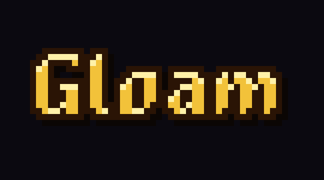
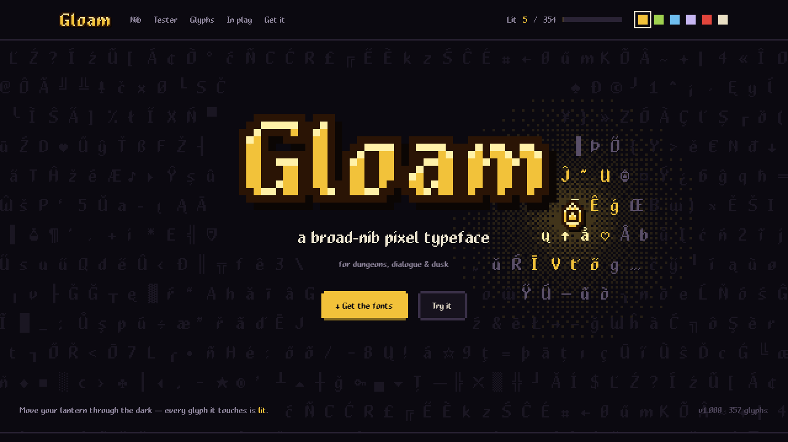
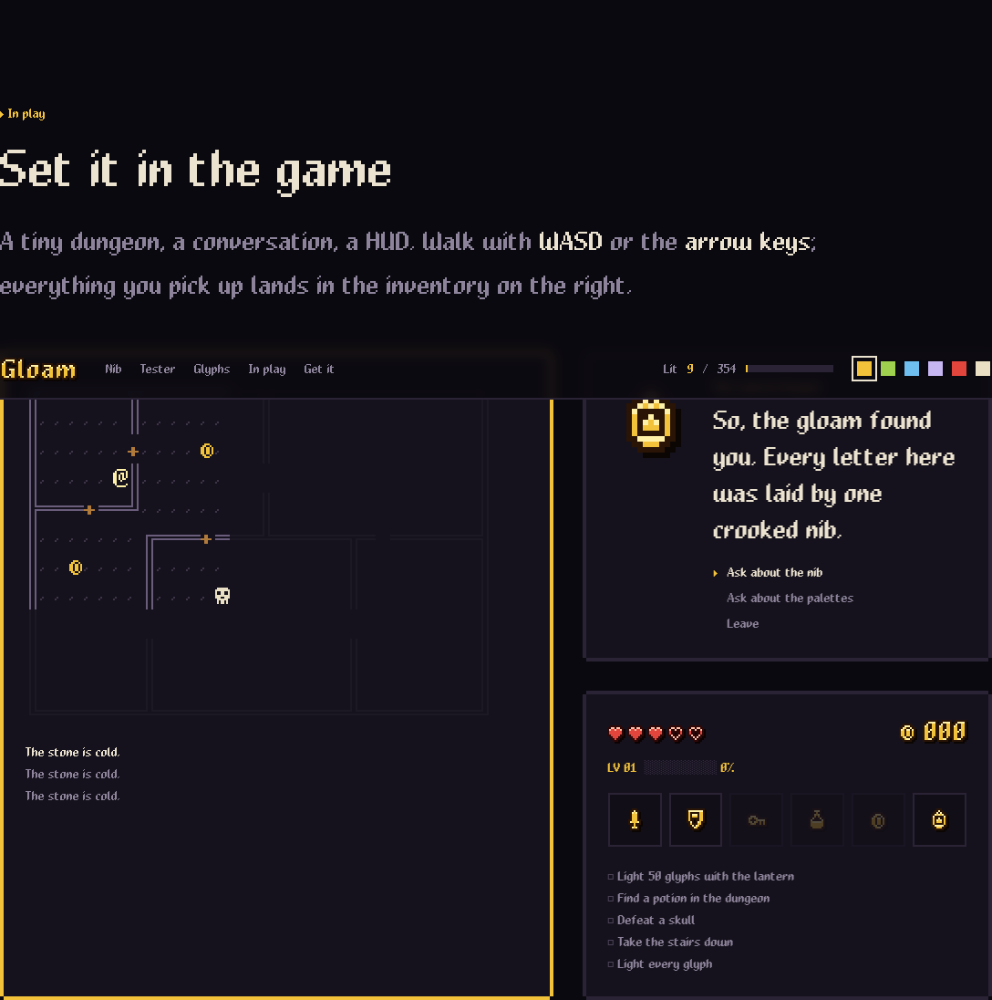

# Gloam



**A broad-nib pixel typeface for dungeons, dialogue and dusk.**
Designed by Tuomas Taini.

Gloam pretends every pixel was laid by a broad pen held at 45°. Strokes that travel ↗ come out **thin** (1 px); strokes that travel ↘ come out **thick** (2 px). That one rule settles every corner, dot and diagonal in the font:

- **Bowls lean.** Rounds are thin at NW and SE and heavy at NE and SW, so counters tilt like ink.
- **Hairline up.** The up-stroke of `A` is the nib's edge, and the down-stroke carries the weight.
- **Slash vs. backslash.** `/` is 1 px and `\` is 2 px. The rule has no exceptions.
- **Nib marks.** The dots on `i` and `j`, periods, colons and umlauts are diagonal ticks rather than squares.
- **Sheared feet.** Stems leave the baseline with a single trailing pixel, the way a pen lifts.


**Specimen:** https://taituo.github.io/gloam/ (the same page is in [`docs/index.html`](docs/index.html))



## Families

| Family | What it is | Files |
|---|---|---|
| **Gloam** | Monochrome outlines | `Gloam-Regular.ttf` · `.otf` · `.woff2` |
| **Gloam Lantern** | COLRv0 colour font: shadow, halo, fill and a highlight on every top edge. Six CPAL palettes. | `GloamLantern-Regular.ttf` · `.woff2` |


Palette indices: `0` Ember · `1` Moss · `2` Frost · `3` Ghost · `4` Blood · `5` Bone.

## Character set

357 glyphs per family:

- Basic Latin and Latin-1, plus the core of Latin Extended-A. This covers Finnish, Swedish, Danish, Norwegian, Icelandic, German, French, Spanish, Polish, Czech, Turkish, Romanian and Hungarian.
- 41 box-drawing, block and shade glyphs on a strict 8 × 16 px cell (single, double and rounded lines, plus `░▒▓█`).
- Arrows, cursors (`▲▼▶◀`), card suits, `♥♡★☆☠⚔♪☾✦`.
- Six game icons in the Private Use Area: `U+E000` key · `U+E001` potion · `U+E002` coin · `U+E003` shield · `U+E004` sword · `U+E005` lantern.


## Grid

| | |
|---|---|
| UPM | 1600, with 1 px = 100 units |
| x-height | 7 px |
| Cap height | 10 px |
| Ascent / descent | 13 / 3 px (the line is exactly 1 em) |
| Pixel-perfect sizes | 16, 32, 48, 64, 96 … px (any multiple of 16) |

Because the line is exactly 1 em, `line-height: 1` keeps box-drawing joined vertically.

## Use on the web

```css
@font-face { font-family: "Gloam";         src: url(fonts/Gloam-Regular.woff2) format("woff2"); }
@font-face { font-family: "Gloam Lantern"; src: url(fonts/GloamLantern-Regular.woff2) format("woff2"); }

@font-palette-values --frost { font-family: "Gloam Lantern"; base-palette: 2; }

h1   { font: 64px/1 "Gloam Lantern"; font-palette: --frost; }
body { font: 16px/24px "Gloam"; -webkit-font-smoothing: none; }
```



## Repository layout

```
fonts/            built fonts (TTF, OTF, WOFF2)
source/glyphs/    every glyph as an ASCII bitmap: lower, upper, figures, extra
source/compose.py accents, box drawing, blocks, kerning
source/build.py   bitmaps → TTF / OTF / WOFF2, plus the COLR/CPAL Lantern font
source/proof.py   pixel-exact PNG proofs, optionally with the Lantern layers
site/             specimen page template and builder
docs/index.html   built specimen (GitHub Pages)
images/           README images
```

## Editing a glyph

Every glyph is drawn as plain text. `#` is ink and `.` is empty, with rows written top to bottom. The header gives the character, then the number of rows below the baseline:

```
@ g 3
..####
.#..##
##..##
##..##
##..##
##.###
.##.##
....##
#...#.
.###..
```

To edit and rebuild:

```sh
pip install fonttools skia-pathops brotli pillow
python3 source/build.py            # writes fonts/
python3 site/build_site.py         # writes docs/index.html
python3 source/proof.py proof.png "Hyvää yötä" --scale 6 --lantern ember
```

## License

Copyright © 2026 Tuomas Taini. All rights reserved.
