# Gloam


**A broad-nib pixel typeface for dungeons, dialogue and dusk.**
Designed by Tuomas Taini.

Gloam pretends every pixel was laid by a broad pen held at 45°. Strokes that travel ↗ come out **thin** (1 px); strokes that travel ↘ come out **thick** (2 px). That one rule settles every corner, dot and diagonal in the font:

- **Bowls lean.** Rounds are thin at NW and SE and heavy at NE and SW, so counters tilt like ink.
- **Hairline up.** The up-stroke of `A` is the nib's edge, and the down-stroke carries the weight.
- **Slash vs. backslash.** `/` is 1 px and `\` is 2 px. The rule has no exceptions.
- **Nib marks.** The dots on `i` and `j`, periods, colons and umlauts are diagonal ticks rather than squares.
- **Sheared feet.** Stems leave the baseline with a single trailing pixel, the way a pen lifts.

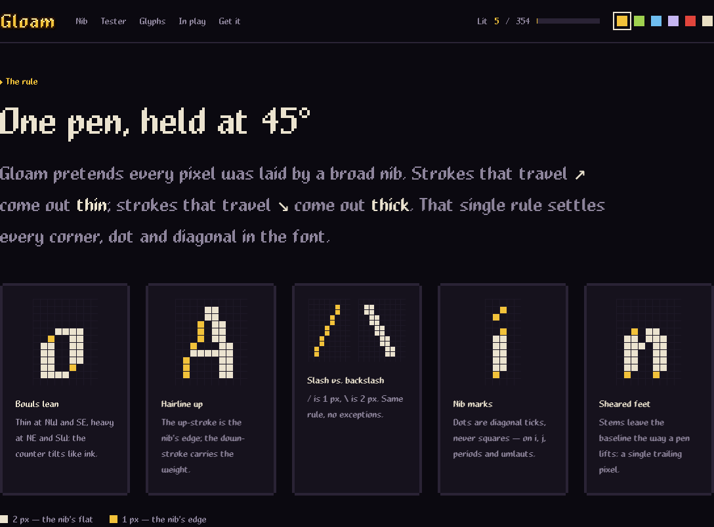

**Specimen:** https://taituo.github.io/gloam/ (the same page is in [`docs/index.html`](docs/index.html))


## Examples

**https://taituo.github.io/gloam/examples/**: three pages that show Gloam in use. All of them are lit with ordered (Bayer) dithering, and they share one small dither engine ([`docs/examples/assets/dither.js`](docs/examples/assets/dither.js)).

| | |
|---|---|
| [**Book**](https://taituo.github.io/gloam/examples/book.html): *The Lantern Keeper of Gloamhollow*, an illuminated pixel book with a tooled-leather cover, aged dithered paper, Lantern drop caps, Pico marginalia, a Finnish page and an interactive night-scene figure. | 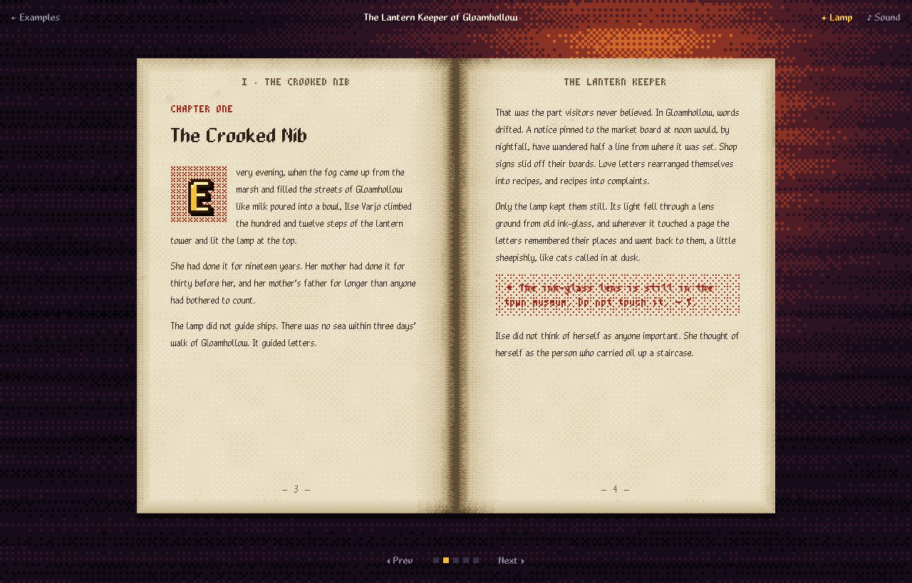 |
| [**Game menus**](https://taituo.github.io/gloam/examples/menus.html): *Quest for the Crooked Nib*. A live 320 × 180 dithered world (aurora, moon, parallax mountains, castle, embers) behind a title screen, main menu, options, saves, codex, dialogue, credits and a quit screen. The options really change the scene's palette and dither matrix (off / 2×2 / 4×4 / 8×8). It has chip sounds and an optional chiptune, and the UI is snapped to the scene's pixel grid. | 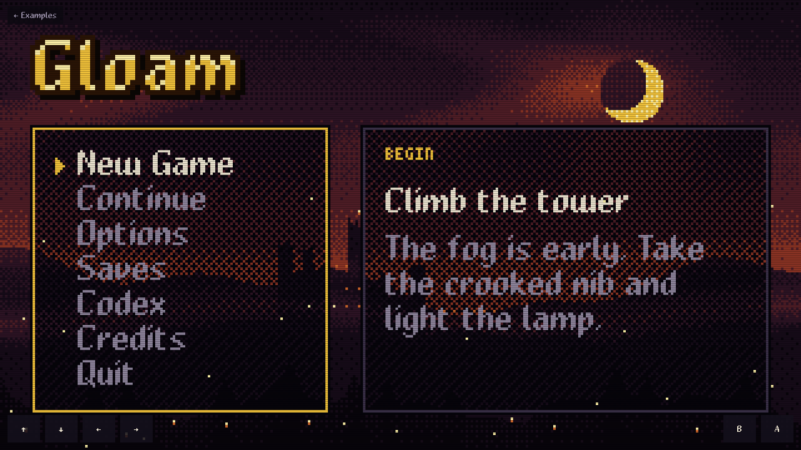 |
| [**Presentation**](https://taituo.github.io/gloam/examples/slides.html): the pitch for Gloam, played as ten stages. It has a HUD with score, hearts and a timer, a boss fight against blurry text, a character-select screen of the seven cuts, a bar chart of ink measured from the sources, an overworld map, and a continue countdown. Every slide change is a different dither transition. | 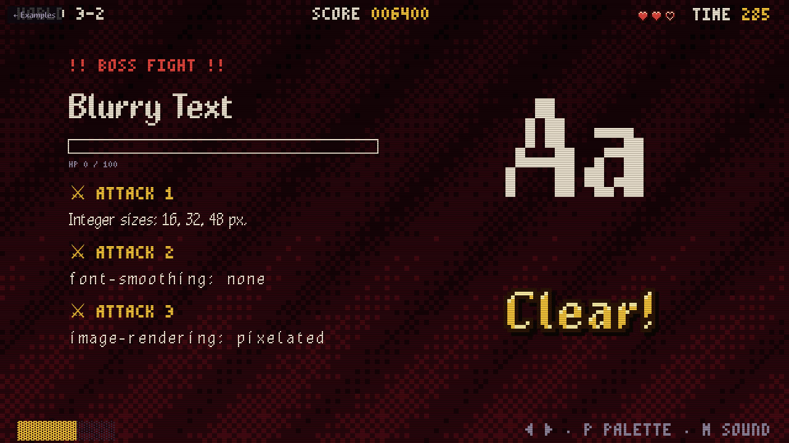 |

## Families

| Family | What it is | Files |
|---|---|---|
| **Gloam** | The full-weight face: 2 px stems, 1 px hairlines | `Gloam-Regular.ttf` · `.otf` · `.woff2` |
| **Gloam Lantern** | Colour version of Gloam (COLRv0) with a shadow, halo, fill and a highlight on every top edge. Six CPAL palettes, Ember by default. | `GloamLantern-Regular.ttf` · `.woff2` |
| **Gloam Bone** | The skinny cut: every stroke is 1 px, drawn by hand on the same grid | `GloamBone-Regular.ttf` · `.otf` · `.woff2` |
| **Gloam Bone Narrow** | Bone with one counter column removed: about 17 % narrower | `GloamBoneNarrow-Regular.ttf` · `.otf` · `.woff2` |
| **Gloam Bone Mono** | Bone in 8 × 16 px cells, the same cell as the box-drawing glyphs | `GloamBoneMono-Regular.ttf` · `.otf` · `.woff2` |
| **Gloam Bone Lantern** | Colour version of Bone, bone palette by default | `GloamBoneLantern-Regular.ttf` · `.woff2` |
| **Gloam Pico** | Fantasy-console terminal face: 3 × 5 capitals and real lowercase in a 4 × 8 cell | `GloamPico-Regular.ttf` · `.otf` · `.woff2` |

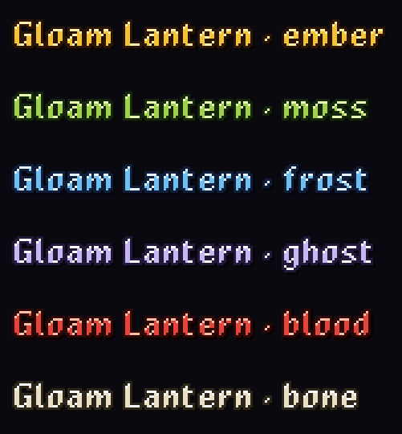

Gloam Lantern palette indices: `0` Ember · `1` Moss · `2` Frost · `3` Ghost · `4` Blood · `5` Bone.
Gloam Bone Lantern palette indices: `0` Bone · `1` Ember · `2` Moss · `3` Frost · `4` Ghost · `5` Blood.

## Gloam Bone

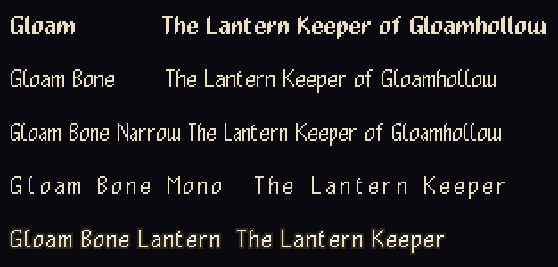

Bone strips Gloam down to one pixel but keeps the nib. Bowls still thin out at NW and SE, branches still rise on the ↗ hairline, ascenders still start with a flick, and dots are still diagonal ticks. Bone is drawn by hand, not produced by a thinning filter. The Narrow and Mono widths are derived from it by code (`source/widths.py`). That code only removes a column when doing so keeps every stroke connected, every counter open, no two strokes touching, and no stroke end cut off.

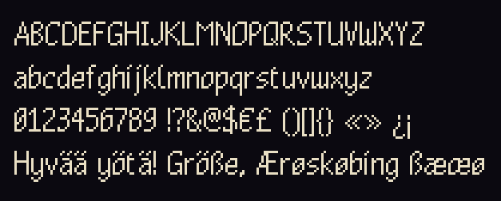

Every Bone Mono glyph is 8 px wide, so text and box drawing share one grid:

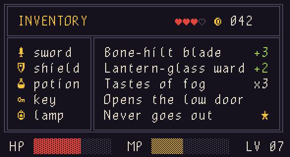

## Gloam Pico, for terminals

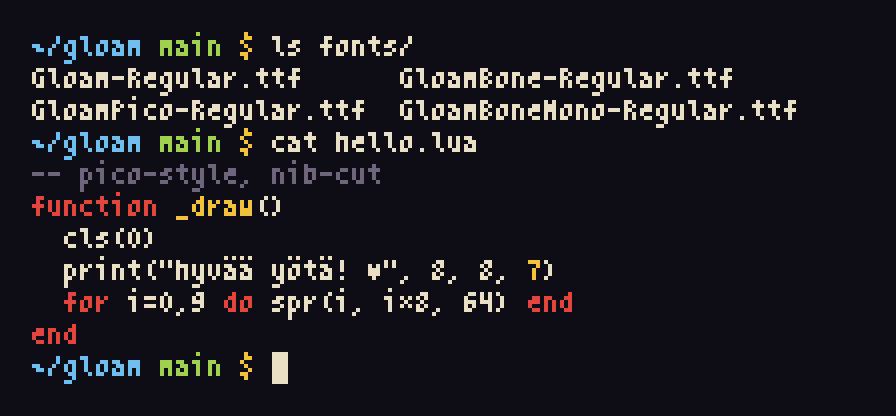

A tiny monospace cut for Ghostty and other terminals. Capitals are 3 × 5 px. Lowercase has a 4 px x-height, with real ascenders and descenders. Every glyph sits in the same 4 × 8 px cell, and the pen rule still shows: `O`, `S`, `o` and `8` are clipped at NW and SE.

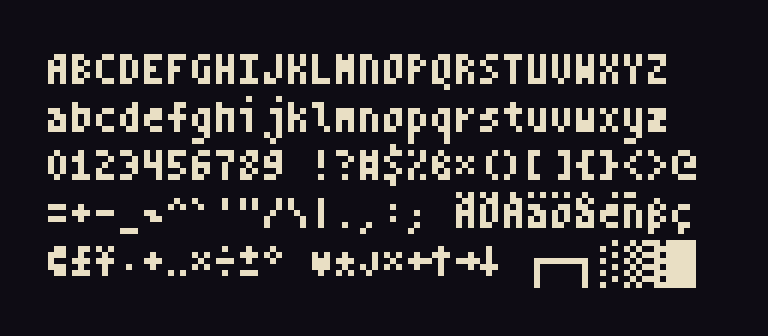

- **Terminal-ready metrics.** Every glyph has the same advance. The cell metrics are whole pixels (UPM 800, 1 px = 100 units, ascent 6 px, descent 2 px). `isFixedPitch` and PANOSE are set to monospaced, so fontconfig reports `spacing=mono`.
- **223 glyphs.** These cover ASCII, the Latin-1 letters (ä ö å é ñ ß ç …), box drawing, blocks and shades, Powerline separators, arrows, ✓ ✗ ♥ ★ and •.
- **Crisp sizes.** The em must be a multiple of 8 device pixels. In Ghostty, `font-size = 12` works on both macOS Retina (3×) and Linux at 96 dpi (2×), and so does `24`.

Ghostty config ([`extras/ghostty.config`](extras/ghostty.config)):

```ini
font-family = "Gloam Pico"
font-size = 12
font-synthetic-style = false               # no smeared fake bold/italic
bold-color = bright                        # Ghostty 1.2+ (older: bold-is-bright = true)
freetype-load-flags = no-hinting,monochrome  # Linux: hard 1-bit pixel edges
font-thicken = false                       # macOS
# adjust-cell-height = 25%                 # optional line spacing, stays on whole pixels
```

Pico has no bold or italic, because at 3 px wide there is no room for either. Turning off synthetic styles and showing bold as bright colours keeps every pixel sharp.

## Character set

357 glyphs in every family except Pico (223, listed above):

- Basic Latin and Latin-1, plus the core of Latin Extended-A. This covers Finnish, Swedish, Danish, Norwegian, Icelandic, German, French, Spanish, Polish, Czech, Turkish, Romanian and Hungarian.
- 41 box-drawing, block and shade glyphs on a strict 8 × 16 px cell (single, double and rounded lines, plus `░▒▓█`). Single lines are 2 px wide in Gloam and 1 px in Bone.
- Arrows, cursors (`▲▼▶◀`), card suits, `♥♡★☆☠⚔♪☾✦`.
- Six game icons in the Private Use Area: `U+E000` key · `U+E001` potion · `U+E002` coin · `U+E003` shield · `U+E004` sword · `U+E005` lantern.

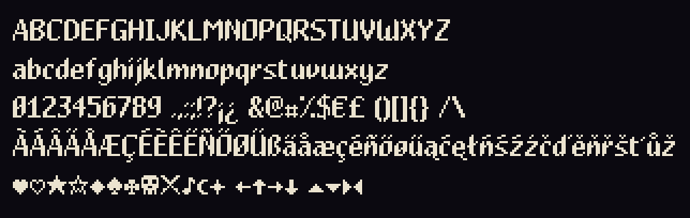

## Grid

| | |
|---|---|
| UPM | 1600, with 1 px = 100 units |
| x-height | 7 px |
| Cap height | 10 px |
| Ascent / descent | 13 / 3 px (the line is exactly 1 em) |
| Pixel-perfect sizes | 16, 32, 48, 64, 96 … px (any multiple of 16) |

Because the line is exactly 1 em, `line-height: 1` keeps box-drawing joined vertically.

## Use on the web

```css
@font-face { font-family: "Gloam";         src: url(fonts/Gloam-Regular.woff2) format("woff2"); }
@font-face { font-family: "Gloam Lantern"; src: url(fonts/GloamLantern-Regular.woff2) format("woff2"); }
@font-face { font-family: "Gloam Bone";      src: url(fonts/GloamBone-Regular.woff2) format("woff2"); }
@font-face { font-family: "Gloam Bone Mono"; src: url(fonts/GloamBoneMono-Regular.woff2) format("woff2"); }

@font-palette-values --frost { font-family: "Gloam Lantern"; base-palette: 2; }

h1   { font: 64px/1 "Gloam Lantern"; font-palette: --frost; }
body { font: 16px/24px "Gloam Bone"; -webkit-font-smoothing: none; }
pre  { font: 16px/1 "Gloam Bone Mono"; }   /* line-height 1 keeps box drawing joined */
```


## Repository layout

```
fonts/            built fonts (TTF, OTF, WOFF2)
source/glyphs/      every Gloam glyph as an ASCII bitmap: lower, upper, figures, extra
source/glyphs-bone/ the 1 px Bone redraws (anything not redrawn is shared with Gloam)
source/compose.py   accents, box drawing, blocks, kerning, per-style setup
source/widths.py    Bone Narrow and Bone Mono width transforms
source/glyphs-pico/ Gloam Pico bitmaps (3 × 5 in a 4 × 8 cell)
source/pico.py      Gloam Pico builder (monospace terminal metrics)
extras/             Ghostty config for Gloam Pico
source/build.py     bitmaps → TTF / OTF / WOFF2 for all six families, plus COLR/CPAL
source/proof.py   pixel-exact PNG proofs, optionally with the Lantern layers
site/             specimen page template and builder
docs/index.html   built specimen (GitHub Pages)
docs/examples/    book, game menus, presentation + dither engine
images/           README images
```

## Editing a glyph

Every glyph is drawn as plain text. `#` is ink and `.` is empty, with rows written top to bottom. The header gives the character, then the number of rows below the baseline:

```
@ g 3
..####
.#..##
##..##
##..##
##..##
##.###
.##.##
....##
#...#.
.###..
```

To edit and rebuild:

```sh
pip install fonttools skia-pathops brotli pillow
python3 source/build.py            # writes fonts/ (Gloam + Bone families)
python3 source/pico.py             # writes fonts/GloamPico-Regular.*
python3 site/build_site.py         # writes docs/index.html
python3 source/proof.py proof.png "Hyvää yötä" --scale 6 --lantern ember
python3 source/proof.py bone.png "Hyvää yötä" --style bone   # bone | bone-narrow | bone-mono
```

## License

Copyright © 2026 Tuomas Taini. All rights reserved.
